<h1 align="center">
  
</h1>

<p align="center">
  <b>MW AGENT</b> is a fork of <a href="https://github.com/huecoder/MD3-Agent">MD3 Agent</a> by huecoder, licensed under GPL v3 like the original. See <a href="#license">License</a>.
</p>

<p align="center">
  Open-source replacement for Gemini on Android. Summon it by gesture, bring your own API key,<br>
  and it reads the screen and operates your phone. Material 3 Expressive, no account, no analytics.
</p>

<p align="center">
  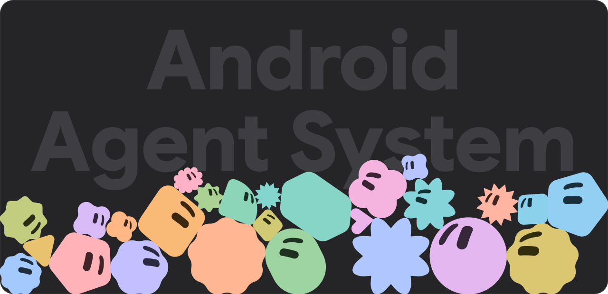
</p>

<p align="center">
  <a href="https://github.com/mwdevpy/mwagent/releases/latest"></a>
  <a href="LICENSE"></a>
  
  
  
</p>

<p align="center">
  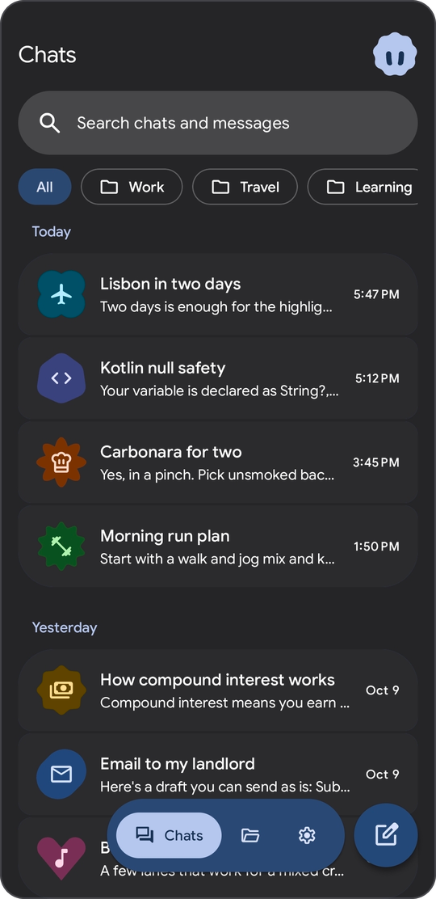
  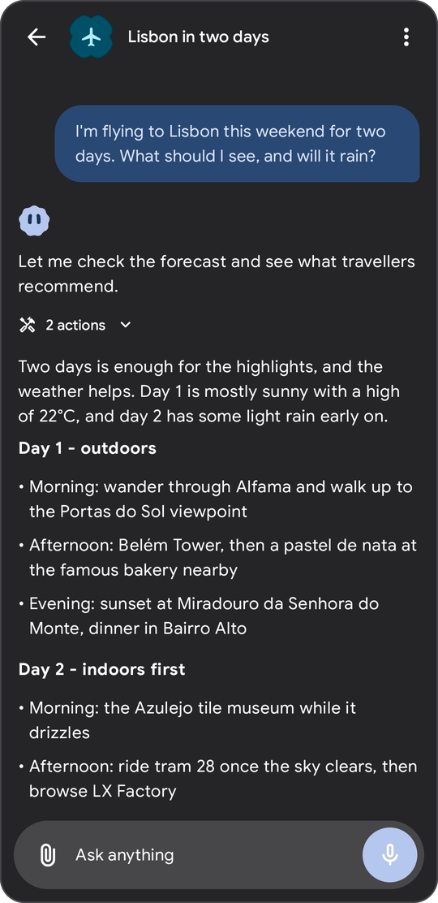
  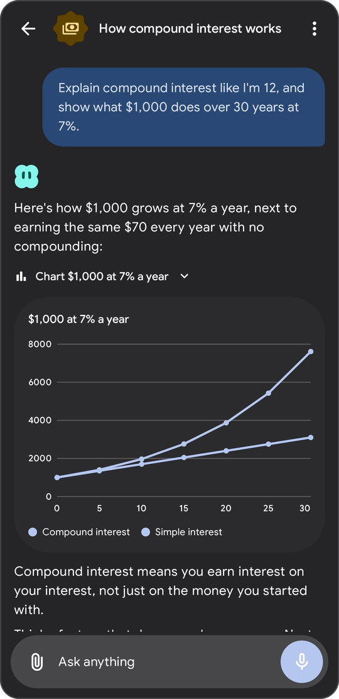
</p>
<p align="center">
  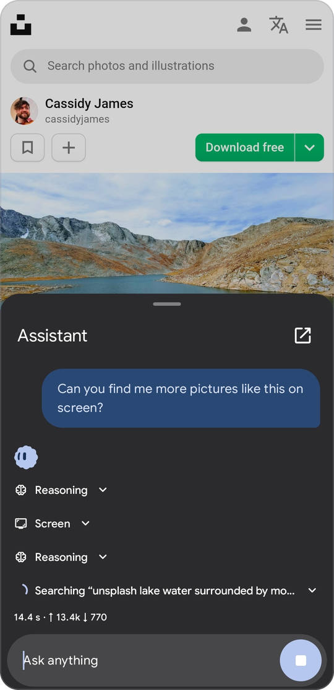
  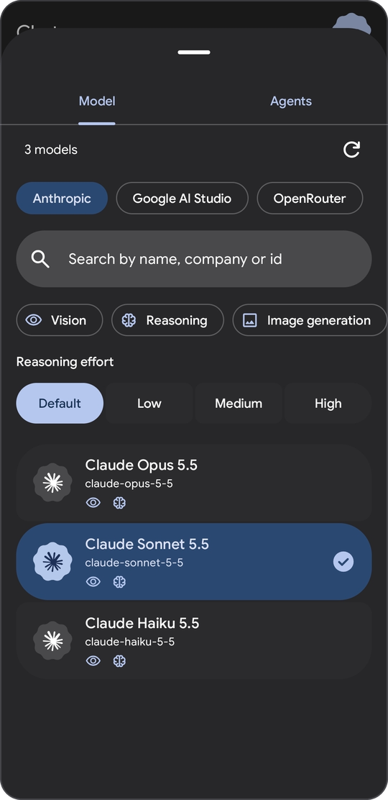
  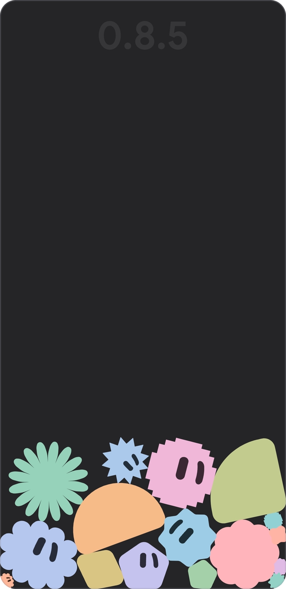
</p>

## What it is

MW AGENT talks to the model provider you choose and hands the model a set of tools. Ask it to check the weather, read a web page, run a Python script, set a reminder, sort a folder or tap through another app, and it does that on your phone. Every tool has an Off, Ask or Auto switch, and the risky ones ask first by default.

It is only a client. There is no backend, no sign-up and no telemetry. Chats live in a local database, API keys are encrypted with the Android Keystore, and the app talks to your provider directly.

The project is at version 0.8, so expect some rough edges. Bug reports are welcome.

## Features

**Providers and models**
- Three native API formats: OpenAI-compatible (OpenAI, OpenRouter, Ollama, LM Studio, anything that serves `/chat/completions`), Anthropic Messages and Google Gemini.
- Custom base URL and any number of extra headers for every provider.
- Live model list from the provider, cached on the device, with search and filters for vision, reasoning and image output.
- Streaming in all three formats, including tool calls and token usage.
- Reasoning effort per chat, with the model's thinking shown in a collapsible block. Signed thinking blocks from Anthropic, thought signatures from Gemini and `reasoning_details` from OpenAI-format servers are kept and sent back while the model works through tool calls.
- Prompt caching for Claude models and image output for models that can draw.

**Chats**
- Folders, archive, a trash that empties after 30 days, swipe actions you can change, and long-press or drag to select many chats.
- Search across titles and message text, with highlighted snippets that jump to the message.
- After the first reply a chat gets a title, an icon, a color and a shape (41 icons, 12 colors, 16 shapes). Change them any time or turn automatic naming off.
- Replies keep streaming in the background when you leave the app, and the notification has a Stop button.
- Drafts per chat, regenerate, and attachments: images are resized, text files are inlined.
- Markdown with highlighted code, charts and flow diagrams drawn in the chat, quick-reply chips, and source pills with favicons.

**Agents**
- Make as many agents as you like. Each one has a name, a system prompt, an avatar shape and color (28 shapes, 12 colors), its own tool permissions and, if you add a voice provider, its own voice. One agent is the default for new chats and every chat remembers its own.
- Prompts accept placeholders: `{agent_name}`, `{date}`, `{time}`, `{weekday}`, `{timezone}`, `{device}`, `{android}`, `{battery}` and `{locale}`.
- The avatar is a small animated character. It morphs through the agent's shapes while it works, blinks, follows what you type and reacts when poked. A hidden playground lets you throw the shapes around with real physics.

<p align="center">
  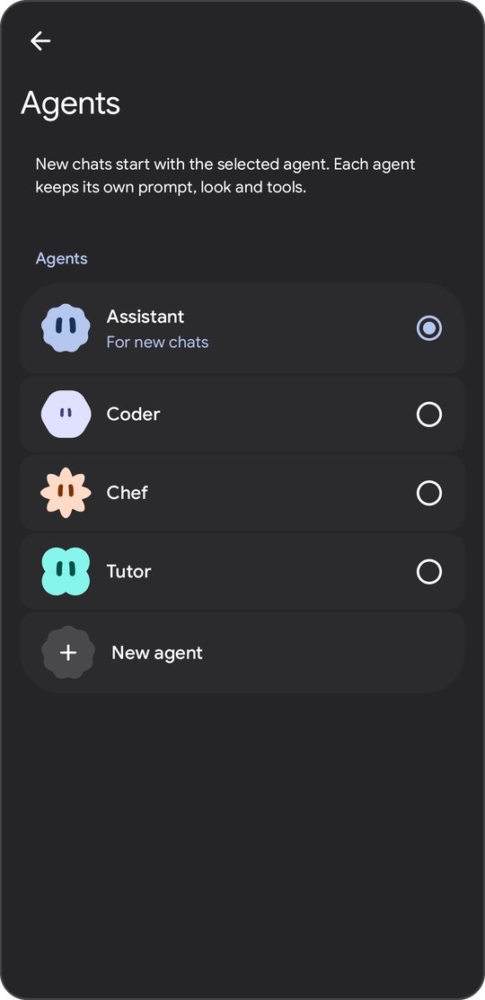
  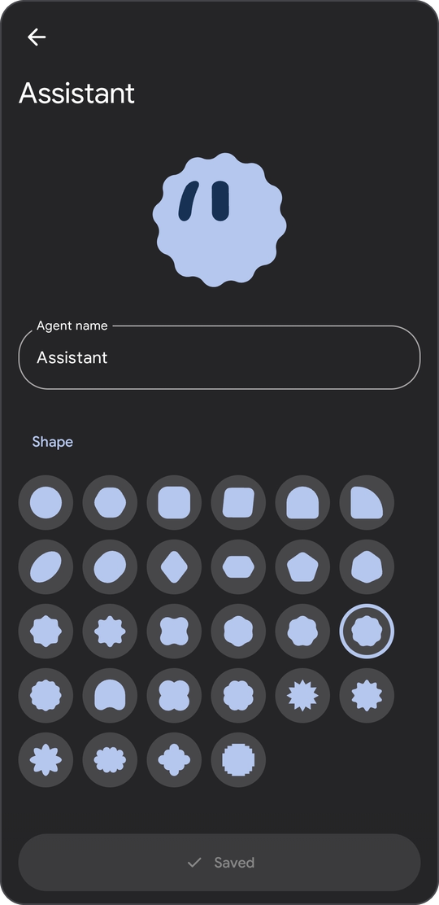
  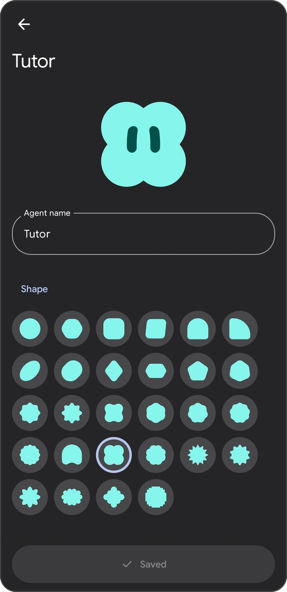
  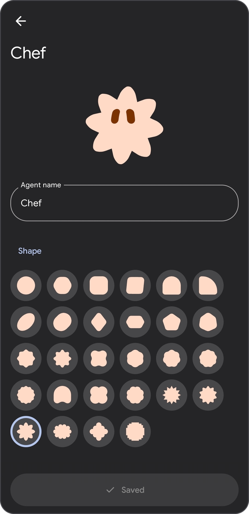
</p>

**Tools**

30 built-in tools plus any number of [MCP](https://modelcontextprotocol.io) servers. Each tool is Off, Ask or Auto, globally in Settings and per agent in the agent editor. An Ask tool pauses the reply and shows a card with the arguments: Allow, Deny, or Always allow in this session. A notification asks if the app is in the background.

<details>
<summary>All built-in tools</summary>

| Tool | What it does | Default |
|---|---|---|
| `web_search` | Search through DuckDuckGo (default), SearXNG or the Brave API | Auto |
| `read_webpage` | Read a page as clean text through Jina Reader (default), directly or a reader of your own | Auto |
| `get_weather` | Current weather and a 1 to 7 day forecast from Open-Meteo | Auto |
| `get_location` | The phone's position with the nearest street address, from GPS or the network | Ask |
| `read_screen` | Text of the app the assistant overlay was opened over | Auto |
| `phone_screen` | The live screen as a numbered list of elements, through the accessibility service | Auto |
| `phone_action` | Tap, type, scroll, swipe, press system keys, open apps | Ask |
| `show_ui` | Quick-reply chips and buttons under an answer | Auto |
| `show_chart` | Line, bar or pie chart drawn in the chat | Auto |
| `show_diagram` | Flow diagram drawn in the chat | Auto |
| `ask_user` | A multiple-choice question that waits for you | Auto |
| `memory_save`, `memory_update`, `memory_delete`, `memory_search` | Manage and search memories | Auto |
| `run_command` | Shell command in the sandbox, Termux, Shizuku or root | Ask |
| `run_python` | Python 3.13 script, standard library only | Ask |
| `list_files`, `read_file` | Browse and read files inside the allowed scope | Auto |
| `write_file` | Write or append text | Ask |
| `send_files` | Show phone files and images in the chat | Auto |
| `set_reminder`, `list_reminders`, `cancel_reminder` | Reminders that notify you and open the chat | Auto |
| `set_alarm`, `set_timer` | Alarm or timer in the system clock app, needs MW AGENT on screen | Auto |
| `list_chats`, `read_chat`, `search_messages` | Look through your other chats | Auto |
| `export_chat` | Save a chat as a Markdown file | Ask |

Tools that come from MCP servers always start as Ask.

</details>

**MCP**
- Remote servers over Streamable HTTP, with a bearer token or OAuth (metadata discovery, dynamic client registration, PKCE).
- Server tools show up as `mcp_<server>_<tool>`, server instructions go into the prompt, and elicitation requests appear as forms in the chat.

**Device access (optional)**
- Shell modes: sandbox (default, no root), Termux, Shizuku or root.
- Phone control through an accessibility service. It reads the screen as numbered elements and refuses to act on MW AGENT's own screen.
- File scope: the app folder (default), phone storage with All files access, or root.
- Python 3.13 through Chaquopy, bundled, standard library only.

**Memory**
- Two tiers: instant memories are always in the system prompt, long-term ones are searched when needed.
- Keyword search by default, with optional embeddings from Gemini or any OpenAI-compatible `/embeddings` server.
- The model manages memories through tools, and you can add, edit and delete them in Settings.

**Voice and assistant**
- Dictation sends your recording to a transcription endpoint of your choice (OpenAI format, Gemini or ElevenLabs). Replies can be read aloud with the system voice or a provider voice.
- Set MW AGENT as the default digital assistant to open a chat sheet over any app. It can read the text of the app underneath through `read_screen`.

**Files, look and feel**
- A Files tab with recent media, your uploads, and the files the agent creates or sends.
- Material 3 Expressive with dynamic color on Android 12 and up, a fixed blue palette on Android 10 and 11, the system dark theme, Google Sans, adjustable haptics and predictive back.
- English and Russian.
- Optional DNS over HTTPS for all network traffic.

## Install

1. Download `mw-agent-<version>.apk` from the [latest release](https://github.com/mwdevpy/mwagent/releases/latest). It needs Android 10 or newer on a 64-bit ARM phone (arm64-v8a).
2. Open the file and allow installs from that app when Android asks.
3. In Settings, open Models and add a provider: choose the API format, paste the base URL (it is prefilled for OpenAI, Anthropic and Gemini) and your key. Then pick a model with the button at the top of a new chat.

If Play Protect stops the install, see [Troubleshooting](#troubleshooting).

The app never updates itself. **Check for updates** in About looks at GitHub Releases only when you tap it, and hands you the download link.

To check that an APK is genuine, run `apksigner verify --print-certs mw-agent-<version>.apk` and compare the SHA-256 digest of the signer certificate with this one:

```
a269959f24a0b8816fbcf313dff1641a0b16a505b2acb8e8701f92a688e411e5
```

## Troubleshooting

**Play Protect says "App blocked to protect your device"**

Play Protect blocks apps that you download with a browser, a messenger or a file manager when they declare an accessibility service, SMS access or a notification listener, because those permissions are often abused for fraud. The dialog says the app "can request access to sensitive data". MW AGENT declares an accessibility service for its phone control tools, so it matches the rule.

The service is optional and does nothing until you switch it on in Android's accessibility settings. The block is a blanket rule for those permissions, not a finding about this app. The code is all here, and you can compare the release with the fingerprint above.

To install it anyway, turn off Play Protect's app scanning: open Google Play, tap your profile picture, choose Play Protect, tap the gear and switch off **Scan apps with Play Protect**, then open the APK again. Google recommends keeping Play Protect on, so whether to turn it back on afterwards is your call. If you only pause the scanning instead, Play Protect can scan the app when it resumes and remove it.

**The accessibility switch is greyed out**

Android restricts accessibility for apps that were installed from outside a store. Open App info for MW AGENT, tap the three dots in the corner, choose **Allow restricted settings**, then switch the service on in Android's accessibility settings.

## Privacy

- No analytics, no crash reporting, no accounts. Chats are stored in a local database on the phone, provider keys and tool settings are encrypted with an Android Keystore key, and cloud backup is switched off.
- Your messages, tool results and attachments go to the provider you configured. Nothing goes to the developer.
- A few tools use public services by default, and each can be changed in Settings: DuckDuckGo for `web_search`, r.jina.ai for `read_webpage` and Open-Meteo for `get_weather`. Source pills load each site's favicon straight from that site. The update check talks to `api.github.com` when you tap it.
- Permissions: internet, vibration, microphone (dictation), notifications, exact alarms and boot (reminders), location (`get_location`, asked for only when you grant it in Device access) and a foreground service (streaming in the background). Termux commands, All files access and the accessibility service for phone control are optional and stay off until you enable them. The app has no access to camera or contacts. Location is read only when a reply calls `get_location`, and that tool asks first by default. Its address lookup uses the system geocoder, which on some phones sends the coordinates to the phone maker's service.

## Build

```bash
git clone https://github.com/mwdevpy/mwagent.git
cd mwagent
./gradlew assembleDebug
./gradlew testDebugUnitTest
```

You need JDK 17 and the Android SDK with platform 37 (`sdk.dir` in `local.properties`, or `ANDROID_HOME`). The wrapper downloads Gradle 9.8. A Python 3.13 on the path is optional: Chaquopy uses it to precompile bytecode, and the build only prints a warning without it. The debug APK ends up in `app/build/outputs/apk/debug/`.

`assembleRelease` needs your own signing key. Create `keystore/keystore.properties` (git-ignored) with `storeFile`, `storePassword`, `keyAlias` and `keyPassword`, where `storeFile` is relative to the project root.

The unit tests run on the JVM and need no device or emulator.

Built with Kotlin, Jetpack Compose, Room, DataStore, OkHttp, Coil, Chaquopy, Shizuku and dyn4j.

## Contributing

Issues and pull requests are welcome. For anything bigger than a small fix, please open an issue first so we can agree on the direction, and run `./gradlew testDebugUnitTest` before you send a change.

## License

GNU General Public License v3.0, see [LICENSE](LICENSE).

MW AGENT is a fork of [MD3 Agent](https://github.com/huecoder/MD3-Agent) by huecoder. It is modified from the original and distributed under the same GPL v3 terms. The original project is not affiliated with this fork and is not responsible for it.

Vendor logos, the Google Sans font and other third-party assets are listed in [THIRD_PARTY.md](THIRD_PARTY.md). Vendor trademarks belong to their owners.
